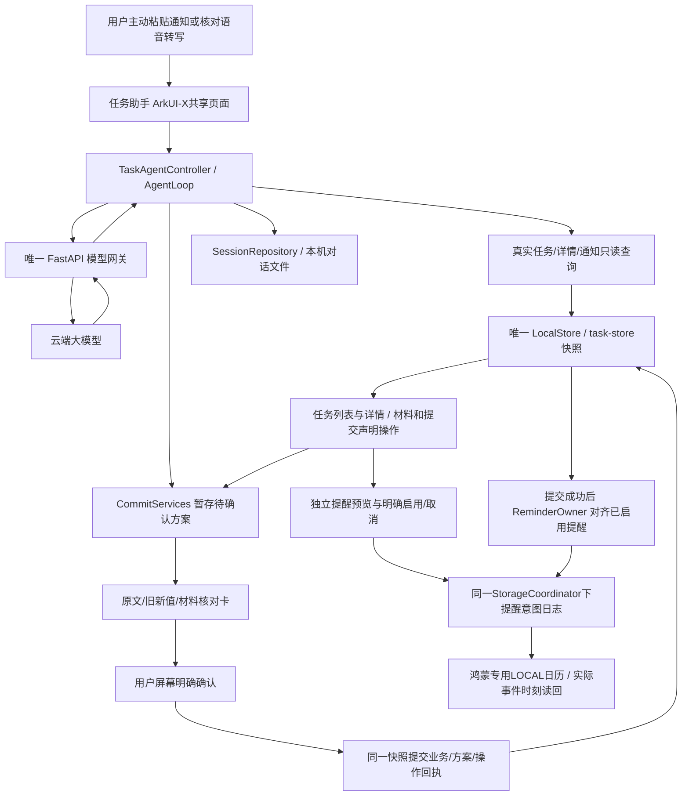

# 课事清：当前实现架构与交接

2026-11-17，面向PR18候选；这是源码架构说明，不代表所有平台或最终验收通过。

模型负责理解原通知和补充、查询真实对象、提出创建/更新方案。模型没有确认权；同名查询的多候选须屏幕选择，用户选中的目标ID/版本限制本轮更新。首次成功暂存后循环停止，后续保存由客户端明确动作完成。语音先转文字供核对，发送和播报都需主动点击。

业务存储包含来源、任务、材料、方案和操作回执，串行队列加revision/任务version检查；v1/v2旧记录保持，新材料状态/声明历史使用v3。提交声明快照保留当时材料、渠道和来源，仅证明用户在本机作出声明。后续要求变化不抹掉旧声明。确认权不在重启后自动恢复，重复提交返回原操作回执。

提醒偏好与系统登记意图不是另一份任务库。先保存pending意图，再发布/读取系统结果；系统与文件不能原子提交，依靠稳定key和冷恢复核对。旧代理提醒实际发布失败后使用本应用专用LOCAL日历，仅查询自有事件标识及所需时间，不使用默认/全部日历或WHOLE权限；有旧代理登记则阻止混用后端。真实回读时刻/提前量/开关，外部改动不会静默覆盖。只清理本模块登记，系统侧删除不自动复活；精确时刻未知时不补23:59，提醒时间不改变正式DDL。日历权限待本人决定，系统提示音与送达另验，不把登记当已响铃。

鸿蒙语音和提醒为平台端口，默认共享入口不伪装已具有原生能力。当前PR新增部分仅完成鸿蒙原生构建；本轮Android/iOS、实际OS到期送达、真实用户试用尚未验证。日期七天列表是截止视图，尚无可用时间/工作块排程，不能当自动安排已实现。

交接核对：A检查主应用入口、页面及平台owner生命周期；B检查新增材料白名单、同名目标选择与真实模型表现；C检查v3兼容、历史快照及并发/冷恢复。v3实际写入后勿直接降级旧客户端或清库，保留原始文件并按协议处理。源码及验证状态见[本轮进度](setup/SILENT_MVP_STATUS.md)，演示见[无声演示步骤](setup/SILENT_DEMO.md)。
