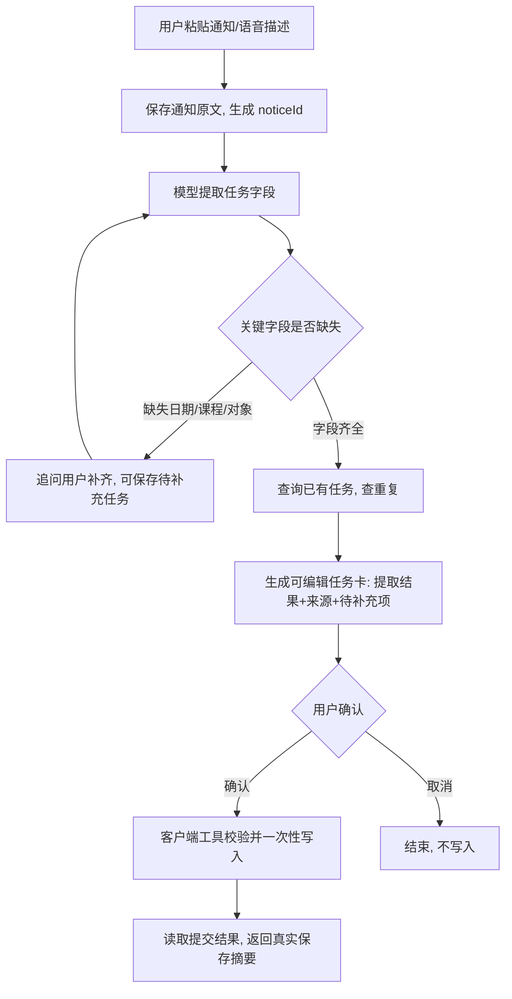
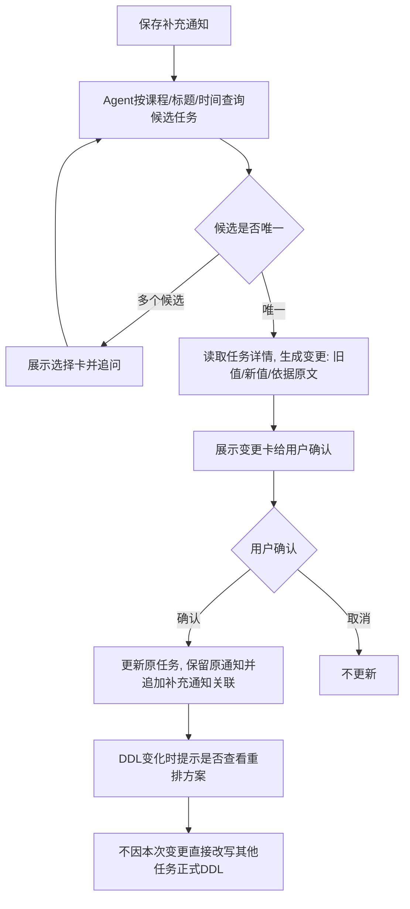
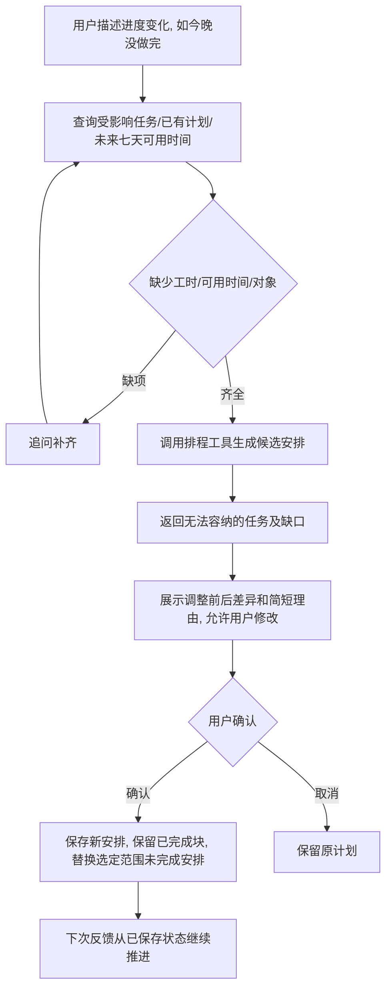
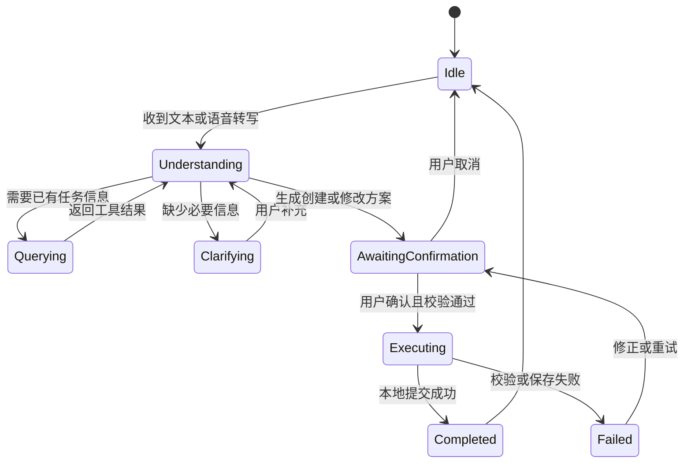

# B-模型Agent准备笔记

> 角色：B（模型与Agent）｜任务：T02 模型候选了解与Agent流程草案
> 依据：项目设计与开发总纲 v0.3（第4、6、9、14节）；四人分工与交付清单
> 评审人：C｜分支：docs/b-agent
> 状态：草案，待C评审后定稿
> 说明：本文是T02资料交付，仅描述设计与计划；真实调用、结构化输出质量、延迟和费用需在T07最小网关中实际验证后再定稿。

## 1. 候选模型选型

### 1.1 候选：通义千问 Qwen（阿里云百炼 DashScope）

| 项 | 内容 | 状态 |
|---|---|---|
| 账号/API Key | DashScope控制台申请，Key放在服务端环境变量 | 待B本人申请 |
| 调用方式 | OpenAI兼容模式 HTTP 接口：`POST /v1/chat/completions` | 待T07实测 |
| 结构化能力 | 支持 `response_format={"type":"json_object"}` 强制JSON | 待T07实测中文效果 |
| 工具调用 | 支持function calling；本项目采用结构化动作协议（见第4节） | 待T07实测 |
| 中文效果 | 对中文校园通知提取优先考察 | 待T07实测 |
| 成本/延迟/频率限制 | 以T07真实调用记录为准 | 待T07实测 |

### 1.2 选型理由与备选

- 选通义千问作首选：国内网络稳定、中文效果好、支持强制JSON结构化输出，适配本项目"通知文本→结构化任务"的核心诉求。
- 备选：DeepSeek（推理与长上下文好）。正式切换需重走T07验证。
- **不在客户端直连大模型**：API Key只放服务端FastAPI网关（`server/`），客户端只访问网关。这样符合安全加分项，也符合总纲"模型网关+密钥管理"设计。

## 2. 三大Agent业务闭环

### 2.1 闭环一：通知转任务

### 2.2 闭环二：补充通知更新任务

### 2.3 闭环三：进度变化后重排

## 3. Agent 状态机（对齐总纲4.5）

**边界（对齐总纲4.5、9.2）：**
- 只读查询可直接执行；新建/修改/删除/计划替换先形成可编辑方案，再由用户确认。
- 每次用户输入最多执行 **8次** 模型/工具步骤；连续两次相同且无新增结果的查询终止并提示补充。
- 模型请求初始超时 **30秒**，可按T07实测调整；不在无反馈状态无限重试。
- 返回格式不合法时最多做 **1次** 结构修复，仍失败则提供人工录入入口。

## 4. 与C对齐：数据字段与工具需求

### 4.1 核心实体字段（对齐总纲8.1，待C在T03定稿）

| 实体 | 主要字段 |
|---|---|
| Notice | id、rawText、sourceLabel、publishedAt、importedAt、timezone、contentHash |
| Task | id、title、course、kind、deadlinePrecision、deadlineDate、dueAt、timezone、priority、status、remainingMinutes、submissionChannel、noticeIds、version、createdAt、updatedAt |
| ChecklistItem | id、taskId、label、state、sourceNoticeId、confirmedAt |
| Proposal | id、sessionId、kind、changes、sourceNoticeIds、expectedRevision、state、createdAt |
| Session / Message | 会话与消息，保存历史回看 |

- `deadlinePrecision`：exact（用dueAt）/ date_only（用deadlineDate）/ unknown（两者为空）。
- 任务状态：todo / in_progress / ready / submitted / done / cancelled（overdue派生，不持久化）。
- 需要C确认：字段类型、JSON序列化命名、Repository接口（get_tasks/get_task_detail/get_notice/get_availability/propose/build_plan/apply_confirmed_proposal）。

### 4.2 工具协议草案（对齐总纲6.1，T17再定稿）

| 工具 | 输入 | 输出/作用 | 是否写入 |
|---|---|---|---|
| get_tasks | 课程、关键词、状态、日期范围 | 真实任务摘要和ID | 否 |
| get_task_detail | taskId | 原DDL、清单、来源、进度、版本 | 否 |
| get_notice | noticeId | 原通知与发布时间 | 否 |
| get_availability | 起止日期 | 可用时间和已占用区间 | 否 |
| propose_task_changes | 创建/修改/删除草案、来源ID | 字段校验、前后差异、待确认方案 | 保存草案，不改变正式任务 |
| build_plan | taskIds、日期范围、偏好 | 候选时间块与未能安排任务 | 否 |
| propose_plan_changes | 新时间块、替换范围 | 计划变更卡 | 保存草案，不改变正式计划 |
| apply_confirmed_proposal | proposalId、operationId、版本 | 校验确认并提交，返回实际结果 | 是，由客户端确认事件触发 |

**错误码约定**：NOT_FOUND、AMBIGUOUS_TARGET、INVALID_ARGUMENT、VERSION_CONFLICT、STORAGE_FAILED、CAPACITY_EXCEEDED（对齐总纲6.2）。

## 5. 与A对齐：网关调用方式

| 项 | 约定 |
|---|---|
| 网关技术 | Python FastAPI（`server/`），承担模型调用与密钥管理 |
| 主接口 | `POST /api/model/turn`：接收当前消息、必要上下文、白名单工具定义、已执行工具结果；返回 answer / tool_calls / clarification（对齐总纲9.1） |
| 健康检查 | `GET /health`（联调和演示前检查服务） |
| 超时 | 客户端到网关、网关到模型，初始各30秒，可实测调整 |
| 错误反馈 | 网关返回 requestId、耗时、错误与用量，不写完整通知/音频/密钥 |
| 加载/异常 | 客户端展示"理解中/查询中/等待确认/保存中"状态；失败保留输入和草案 |

## 6. Agent 待验证风险清单

| 风险 | 现象 | 应对方案 | 验证时机 |
|---|---|---|---|
| 模型输出格式异常 | 夹带文字，无法解析JSON | 强制JSON + 结构校验；最多修复1次；仍失败给人工录入入口 | T07/T12 |
| 关键字段缺失 | 缺日期、课程、对象 | 追问补齐，可先保存待补充任务，不擅自设日期 | T12/T20 |
| 时间歧义 | "下周五"发布时间未知 | 以通知发布时间为锚点；无法确定就追问，不按今天推断 | T12 |
| 同名任务冲突 | 多候选无法区分 | 展示选择卡并追问，不静默覆盖 | T20/T23 |
| 最大Agent轮次 | 陷入无限循环 | 每次输入最多8次模型/工具步骤；连续2次相同查询终止 | T29 |
| 网络/服务超时 | 断网、模型超时 | 保留输入和草案；本地历史可看；不在无反馈状态无限重试 | T29 |
| 重复确认 | 用户连续点击 | operationId去重，一次写入 | T16/T17 |
| 版本冲突 | 草案期间数据被改 | expectedRevision检查，重新生成差异并确认 | T16/T17 |
| 工具执行失败 | 保存失败 | 不显示成功；返回可恢复的修正/重试操作 | T17/T29 |

## 7. 待办与依赖

1. 【需C评审】核对Notice/Task/ChecklistItem字段、Repository方法与工具返回、错误码。
2. 【需A配合】确认 `/api/model/turn` 请求响应示例、超时与错误反馈格式。
3. 【T07】搭建最小FastAPI网关，完成一次真实通义千问调用，实测JSON结构化、中文效果、延迟与费用。
4. 【T12】实现通知提取与多轮补齐，产出可编辑任务草案。
