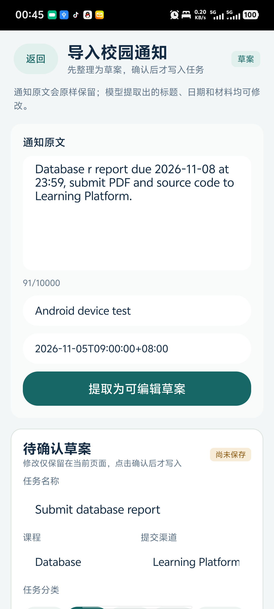
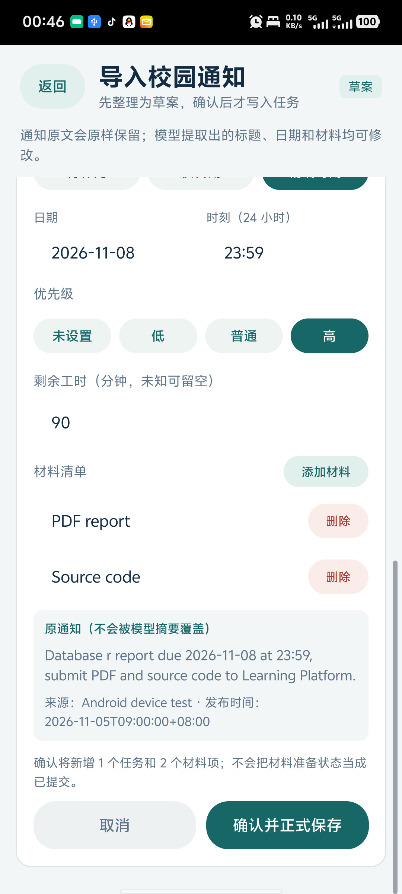
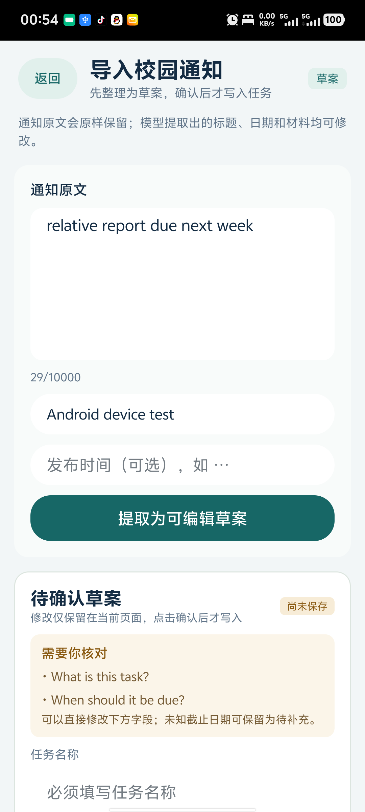
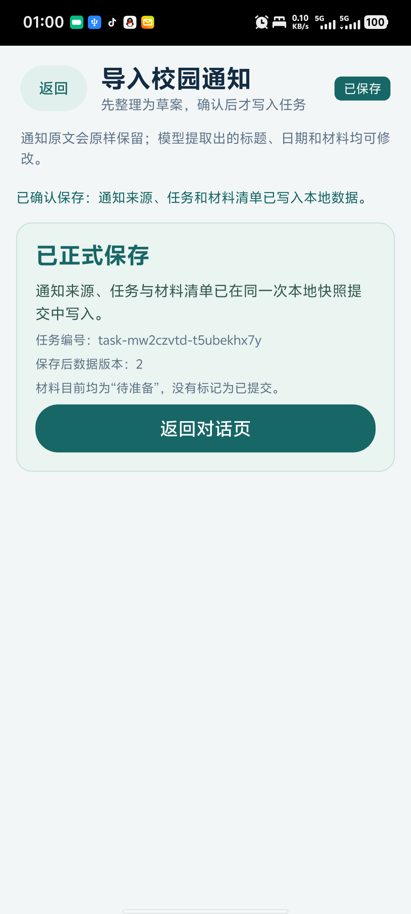
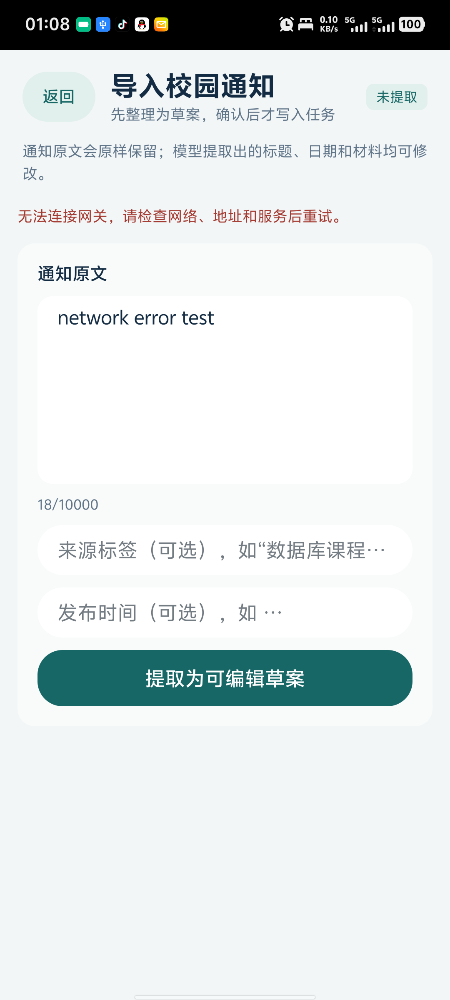
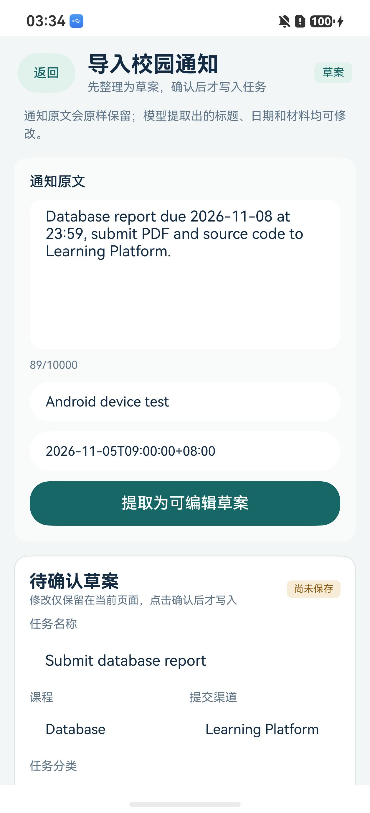
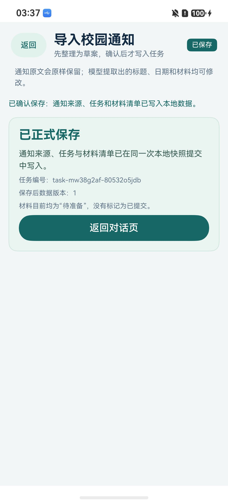
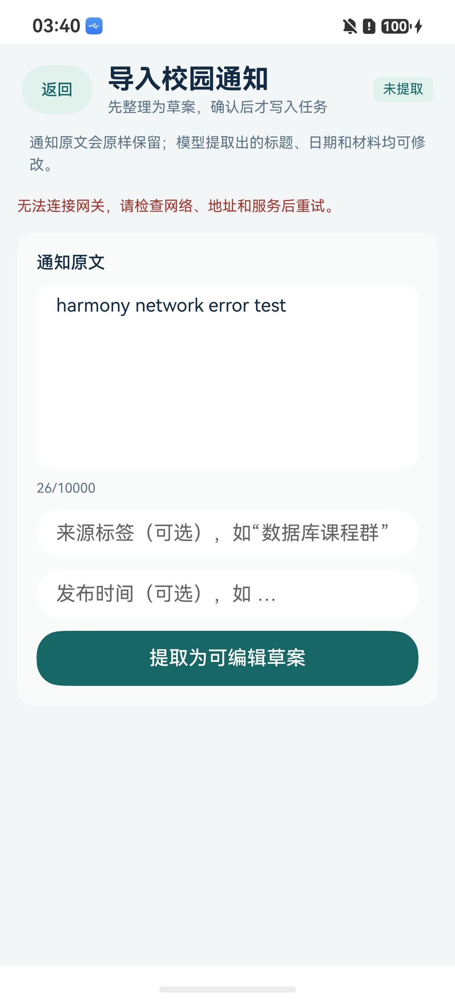
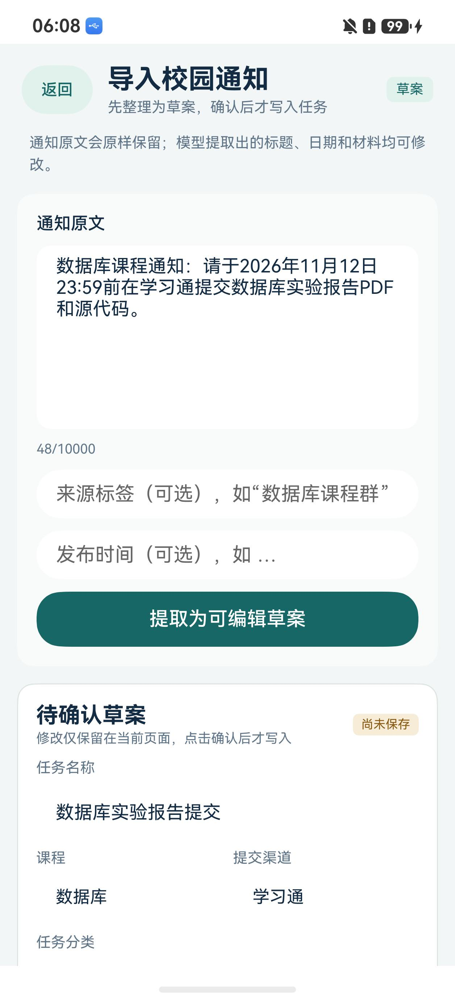

# A：T13 通知输入与创建确认卡

> 负责人：A｜任务：T13 通知输入与创建确认卡
> 依赖：B 的 T12 提取草案、C 的 T03/T08/T14 数据契约与 LocalStore
> 分支：`feat/a-t13-notice-confirm`
> 状态：客户端实现、主机检查、双端工程构建、两端真机契约流程和鸿蒙真实模型闭环完成；Android 真实模型复跑与 PR 评审仍待完成

## 1. 本次交付

- 主对话页新增“导入通知”入口，进入共享 ArkUI-X 页面 [NoticeImport.ets](../../client/entry/src/main/ets/pages/NoticeImport.ets)。
- 通知原文、来源标签、发布时间和 10000 字符上限输入后，调用 B 的 `POST /api/agent/extract-notice`。
- 显示醒目的“待确认草案 / 尚未保存”状态；标题、课程、分类、截止精度、日期时刻、优先级、剩余工时、提交渠道和材料清单均可编辑。
- 未知截止日期保留为 `unknown`，日期级截止保留为 `date_only`；页面不会把仅日期补成 23:59。
- 取消、网络失败、模型失败和迟到响应均不会新增任务；失败时保留原文和当前草案。
- 用户点击“确认并正式保存”后，`Notice`、`Task` 和全部 `ChecklistItem` 在同一个业务快照 revision 中一次提交。
- 保存后展示正式任务 ID 与提交后的 revision，并明确材料仅为“待准备”，不代表已提交。

## 2. 模块边界

| 模块 | 文件 | 职责 |
|---|---|---|
| 草案模型 | [NoticeDraftModels.ts](../../client/entry/src/main/ets/notice/NoticeDraftModels.ts) | 严格解析 T12 草案；拒绝无效时间、优先级、材料和截止字段组合 |
| HTTP 协议 | [NoticeImportProtocol.ts](../../client/entry/src/main/ets/notice/NoticeImportProtocol.ts) | 构造提取请求，校验 HTTP/JSON/草案响应，统一错误反馈 |
| 页面控制器 | [NoticeImportController.ts](../../client/entry/src/main/ets/notice/NoticeImportController.ts) | 提取、字段编辑、取消、加载状态、确认保存和迟到响应保护 |
| 原生适配 | [ArkNoticeExtractionTransport.ets](../../client/entry/src/main/ets/adapters/ArkNoticeExtractionTransport.ets) | 两端共享的 HTTP 请求、Bearer 凭证、超时和句柄释放 |
| 原子导入 | [NoticeImportRepository.ts](../../client/entry/src/main/ets/data/NoticeImportRepository.ts) | 校验确认后的字段，生成保存期字段，同快照写入通知、任务与材料 |
| 原文哈希 | [Sha256.ts](../../client/entry/src/main/ets/data/storage/Sha256.ts) | 无第三方依赖的 UTF-8 SHA-256；两端生成相同的 `contentHash` |

正式保存仍使用 C 的 LocalStore compare-and-save 边界。页面读取当时的业务 revision，若提取草案形成后本地数据发生变化，保存返回 `VERSION_CONFLICT`，草案保留并要求重新读取/确认；不会自动覆盖。

## 3. 保存语义

确认后生成以下关联：

```text
Notice.id ← Task.noticeIds
Task.id   ← ChecklistItem.taskId
Notice.id ← ChecklistItem.sourceNoticeId
```

规则：

- `rawText` 原样保存，不用模型摘要覆盖；`contentHash` 为该 UTF-8 原文的 SHA-256。
- `importedAt` 与任务 `createdAt`/`updatedAt` 使用客户端带偏移时间；任务 `version=1`、`status=todo`。
- `priority` 与 `remainingMinutes` 只取用户在确认卡上的选择；未知工时保存为 `null`，用户明确输入 `0` 才保存为 0。
- 材料项初始 `state=pending`、`confirmedAt=null`，并引用同一次导入的通知。
- 单次 `LocalStore.save` 写入整个业务快照，不会出现“任务已写入但来源缺失”的页面成功。
- 同一页面在保存期间和保存成功后禁止再次确认；T16 的持久 `operationId`、冲突重放和完整确认协议仍是后续任务，本实现不能宣称已具备崩溃后幂等。

## 4. 错误与恢复

| 场景 | 页面行为 |
|---|---|
| 未配置网关 | 提示返回对话页填写网关地址和项目凭证 |
| 原文为空/过长 | 不发起请求 |
| 模型超时或断网 | 保留原文和已有草案，可手动重试 |
| 响应非 JSON 或草案字段非法 | 不渲染为可信草案，保留原文 |
| 用户取消/离开页面 | 取消请求；原文保留；不保存任务 |
| 标题为空、截止日期非法、工时非法 | 本地阻止保存，保留所有输入 |
| 本地 revision 冲突 | 不覆盖；提示重新读取/提取后确认 |
| 文件写入失败 | 保留草案，不显示“已保存” |

## 5. 主机检查

运行：

```powershell
$env:T08_TYPESCRIPT_PATH='<DevEco Studio>/plugins/codelinter/node_modules/typescript'
node scripts/test-notice-import.cjs
```

2026-11-04 主机结果：

- 26 个共享 TS 源文件严格类型检查通过。
- 10 项 T13 专项检查通过。
- SHA-256 对空文本、中文、emoji、10000 字符文本与 Node `crypto` 结果一致。
- T12 三条草案样例严格解析通过；畸形日期、优先级和材料状态被拒绝。
- 控制器完成提取、字段编辑、确认、取消、网络失败和迟到响应保护。
- 真实临时文件检查确认 Notice/Task/Checklist 同 revision 保存、来源引用、原文哈希、`null`/`0` 区分以及 version 冲突不覆盖。
- 模拟原生 HTTP 边界确认请求只写到 `/api/agent/extract-notice`，凭证、超时、缓存关闭和句柄释放符合约定。

机读摘要见 [T13 构建证据](evidence/t13-build-20261104.json)。

## 6. 平台构建

本轮从 Android 官方镜像外的华为官方 SDK 服务下载了 ArkUI-X 26.0.0.28 Beta2，官方归档 SHA-256 `07182b4be1568ed941fd2538423231485e953b7684b23dfbd5909c09b195a33b` 与清单一致，并解压到 Git 忽略的 `runtime/arkuix-sdk`。

使用官方 ACE 1.0.0、HarmonyOS SDK 26.0.0、DevEco Studio 26.0.0.821 和 Studio Node 构建：

```powershell
cd client
ace build hap --debug
```

结果：共享 ArkTS 编译通过，66 个任务完成，`BUILD SUCCESSFUL`。未签名 HAP：

| 项 | 值 |
|---|---|
| 文件 | `client/entry/build/default/outputs/default/entry-default-unsigned.hap` |
| 大小 | 629897 字节 |
| SHA-256 | `021ce737949564bcfdf095241ecaecc39bc5abf4e4e3e15249814f645c690651` |

HAP 未配置调试签名，因此不能作为真机安装包；工程编译和打包已通过，不等于安装运行通过。现有告警包括既有 `pushUrl`/`router.back` 弃用提示、文件 API 异常处理提示和 Hypium 依赖的 ArkTS 规范提示，未阻止构建。

Android 构建环境补装了以下已校验组件：

- Android command-line tools 19.0，Google 官方 SHA-1 `54a582f3bf73e04253602f2d1c80bd5868aac115`。
- Platform Tools 37.0.1，官方 SHA-1 `e03e78b1d80b396f1c3358e31251cb31740e1110`。
- Android Platform 33 revision 3，官方 SHA-1 `394bc86d8d3452aa4d419b67743025a6fb2cd9d0`。
- Build Tools 30.0.3，官方 SHA-1 `fc165c721b8d2da55e6fede467526c81f562be7b`。
- Eclipse Temurin JDK 17.0.20.1+1，Adoptium 官方 SHA-256 `e53a79c3c3d86865bd7e787903884331068e71321714ffd44f145785affc7cb0`。

Android SDK 与 Gradle 依赖的下载复用腾讯/清华公开镜像，但归档均按 Google/Adoptium 官方校验值验证。DevEco 自带 JDK 25 不能运行 Gradle 8.4；改用 JDK 17 后，将 Android 工程仓库中的已停用 `jcenter()` 改为阿里云/华为云 Maven 镜像、Google Maven 和 Maven Central，再执行：

```powershell
ace build apk --debug --target-platform arm64
```

结果：Gradle 32 个任务全部执行，`BUILD SUCCESSFUL`。APK `aapt2` 显示包名 `com.campusddl.agent`、min API 26、target/compile API 33、仅 `arm64-v8a`；`apksigner` 验证 v2 调试签名通过。

| 项 | 值 |
|---|---|
| 文件 | `client/.arkui-x/android/app/build/outputs/apk/debug/app-debug.apk` |
| 大小 | 47281289 字节 |
| SHA-256 | `c3ffd9b7755ae2e63838b77f2764249c9111b7cc3ea07fcf60ceb9cc57c08d24` |

### 6.1 Android 真机验证

2026-11-05 使用 V2364A（Android 16 / API 36 / arm64）完成真机验证。手机上已有一个使用其他调试证书签名的旧包，因此不能覆盖安装而不清除其数据；本轮从同一提交 `a4ae118` 导出临时源码副本，仅在运行目录给调试包增加 `.t13` application ID。该差异不进入 PR，原应用没有被卸载或清数据。

当前环境没有 DeepSeek API Key，因此真机提取使用只存在于 Git 忽略运行目录的确定性契约模拟服务，不把结果写成真实模型调用。T12 真实接口与网关的 66 项、43 项主机检查另行通过。真机已确认：

- 主页面可进入导入页，长表单可滚动，返回与固定页头可用。
- 精确截止草案正确显示来源、发布时间、标题、课程、渠道、DDL 和材料。
- “待确认草案 / 尚未保存”与正式保存成功状态区分清楚。
- 取消保留原文且未生成任务。
- 缺项草案显示标题/截止追问，`unknown` 截止不会被补成 23:59。
- 用户可修改标题、精确日期时刻、优先级和剩余工时。
- 确认后 Notice、Task、ChecklistItem 同快照提交；三次确认把 revision 从 1 增至 3。
- 冷启动取得新进程后，revision 2 的业务快照字节完全不变，已有任务仍可读取。
- 停止模拟网关后显示网络错误，原文保留，revision 与任务数不变。











机读结果见 [Android 真机验证证据](evidence/t13-android-device-20261105.json)。

### 6.2 HarmonyOS 真机验证

2026-11-05 在 ADY-AL10（Pura 70 / HarmonyOS 7.0.0.109 / API 26 / arm64）完成：

- 自动调试签名配置生成，签名 HAP 构建成功并实际安装。
- 真机显示共享 ArkUI-X 主页面和通知导入页。
- 契约模拟提取的草案正确渲染来源、标题、课程、渠道和精确截止时间。
- 取消操作保留原文，没有创建任务。
- 首次确认保存成功后显示 revision 1。
- 强制停止并冷启动后再次保存，成功页显示 revision 2，证明已有业务快照被恢复并继续提交。
- 停止模拟网关后显示网络错误，未生成新草案。
- 恢复有效 DeepSeek 密钥后，真实模型从中文通知中提取标题、课程、精确截止、学习通渠道和两项材料；确认后保存为 revision 3。

签名 HAP SHA-256：`d93b8add3d91e505c8b64df4ce759b09bbf9f9cc69cc95f1d3b836c12489ca38`。签名私钥、证书、Profile 和本机路径不进入仓库。










机读结果见 [HarmonyOS 真机验证证据](evidence/t13-harmony-device-20261105.json)。

### 6.3 仍需完成

鸿蒙端真实模型与持久化闭环已通过。仍需重新连接 Android 设备，在同一有效密钥下复跑真实提取并确认保存；同时获取 PR 评审意见。

## 7. 与其他任务边界

- T12 仍负责模型提取质量与多轮 `answers` 协议；本页直接编辑字段，不冒充已实现 Agent 工具循环。
- T16/T17 仍负责 operationId、持久确认和 Agent 工具提交；当前页面只完成用户确认后的本地同快照导入。
- T18 仍负责正式任务列表、详情和来源浏览；成功页本次只显示提交结果，不提前标为任务列表完成。
- T21/T24 的变更卡、清单提交和七日计划尚未包含在 T13。
