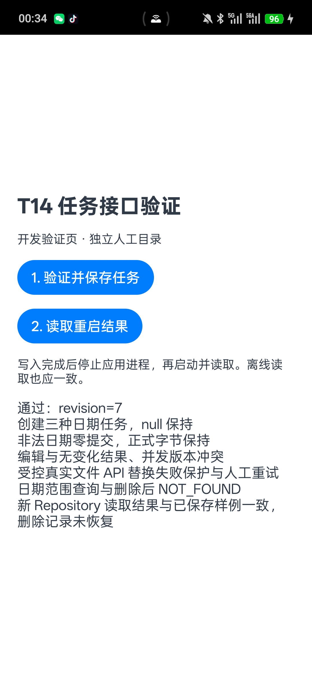
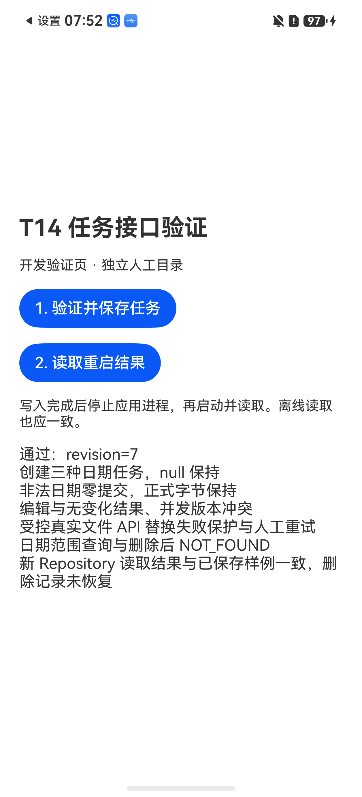

# T14：任务 Repository 与日期校验

负责人：C。基线为 main `b6032c0`（含已合并 T08/T10）；任务分支 `feat/c-t14-task-repository`。代码、主机检查、双端构建及同源 Android/鸿蒙真机技术验证已完成，鸿蒙补齐日期为2026-11-02。A/B 独立接口评审及最终验收待完成，暂不合并。运行源码固定于 `8f964ff356fc8d9f21bdb325d1b6cd4760880405`，后续说明/证据提交不改运行源码。

## 1. 范围与使用边界

实现 [TaskRepository](../../client/entry/src/main/ets/data/TaskRepository.ts)、[契约](../../client/entry/src/main/ets/domain/TaskContracts.ts)、[领域校验](../../client/entry/src/main/ets/domain/TaskValidation.ts)及[日期规则](../../client/entry/src/main/ets/domain/DateRules.ts)。应用级 `getClientStorage(context.filesDir).tasks` 与 LocalStore/SessionStore 复用同一存储所有者和 coordinator。

Repository 是客户端内部领域接口。A 可在用户确认的人工任务操作中调用；B 后续通过 T16/T17 的受控工具与确认流程接入，**不能把这些写方法或 LocalStore.save 直接注册为模型工具**。本轮不实现 Proposal 确认记录、operationId 去重、跨文件事务或完整状态转换。

任务来源引用已有 Notice；`get` 同时返回关联通知和材料项。T14 不实现通知导入、原文哈希生成、清单编辑或补充通知合并，这些由后续来源/状态模块提供。无来源的人工任务使用空 noticeIds。

## 2. 接口

所有方法异步返回 `StorageResult<T>`：`success/data/errorCode/message`。失败时 data=null；错误消息不回显私有文件路径。

| 方法 | 参数 | 成功 data |
|---|---|---|
| `list(query = new TaskQuery())` | 关键词、课程、状态、日期范围 | `TaskList {tasks, revision}` |
| `get(taskId)` | 持久化 ID，不用标题定位 | `TaskDetail {task, notices, checklistItems, revision}` |
| `create(draft, expectedRevision)` | 完整 TaskDraft、读取时的快照版本 | `TaskWrite {task, revision, changed, deleted}` |
| `update(taskId, draft, expectedRevision, expectedVersion)` | 完整替换可编辑字段，两个预期版本都必填 | 同上；无变化时 changed=false，版本不增加 |
| `delete(taskId, expectedRevision, expectedVersion)` | 明确 ID 和两个预期版本 | 同上；deleted=true，返回被删除任务的副本 |

`TaskDraft` 是带默认值的类：title 默认空（必须填写），course/kind/priority/remainingMinutes/submissionChannel 默认 null，deadlinePrecision=unknown、deadlineDate/dueAt=null、timezone=Asia/Shanghai、status=todo、noticeIds=[]。使用 `new TaskDraft()` 后明确赋值；传来的 JSON 必须包含完整字段，缺键不会被静默当作 null。update 为完整替换，不是局部 patch；页面应从详情逐项复制可编辑字段，保留未编辑内容。

ID 由客户端运行时生成并在当前快照检查碰撞，最多尝试8次，碰撞耗尽返回 INVALID_ARGUMENT，不覆盖已有任务。测试可以注入 `TaskRuntime {now(), nextId()}`。默认 ID 是不透明本地记录标识，不用于认证或 T16 operationId。输入中的 id/version/createdAt/updatedAt 不控制正式元数据。

创建 version=1，createdAt=updatedAt=客户端带偏移时刻。实际修改保持 id/createdAt，version 与快照 revision 各增加1。无变化编辑先核对版本再返回原结果，既不写文件也不增加版本。客户端时钟早于上次更新时间时拒绝修改，避免 audit 时间倒退。

查询默认返回所有任务，按 createdAt 的真实时刻、再按 id 排序。同名任务全部返回，不猜测唯一候选。

- keyword 在标题和课程中忽略大小写匹配；course 是精确匹配。
- statuses 为空时不过滤；其他值须为现有状态枚举。
- dateFrom/dateTo 是有效 YYYY-MM-DD，边界包含当天，可单边指定，起始不能晚于结束。
- 日期范围内，date_only 保留原日期；exact 投影到 query.timezone 后比较；unknown 默认排除，includeUndated=true 时明确加入。无日期范围时包括未知日期。
- 时区首版明确支持 Asia/Shanghai、UTC、Etc/UTC；其他值返回 INVALID_ARGUMENT，不落到宿主机默认时区。上海日期投影使用当前 UTC+08:00 规则；历史夏令时及其他 IANA 时区规则留 T30，不能据此声称已验证。

## 3. 日期与输入校验

公历日期范围 0001-01-01～9999-12-31，按月天数及闰年规则验证。1900/2100不是闰年，2000是闰年；不存在的日期拒绝，不依赖 Date.parse 的溢出归一化。

| 精度 | deadlineDate | dueAt |
|---|---|---|
| unknown | null | null |
| date_only | 有效 YYYY-MM-DD | null |
| exact | null | 有效显式偏移时刻 |

exact 采用 `YYYY-MM-DDTHH:mm:ss[.SSS](Z或±HH:mm)`：秒必填、小数1～3位；小时00～23、分秒00～59；偏移最大±14:00，不接受±14:01、闰秒、24:00、本地无偏移时刻或表示未知偏移的-00:00。不强迫 dueAt 的偏移等于展示时区，二者分别表示真实时刻与展示规则。过去日期允许保留，不擅自改到未来；仅日期永不补23:59。

TaskDraft 校验文本、枚举、非负安全整数/显式null、来源非空与不重复；LocalStore 再检查来源实体存在。移除仍被该任务材料引用的通知来源会被拒绝。0不等于null，remainingMinutes=0不自动改变任务提交状态。有限JSON检查在等待文件队列前捕获请求副本，后续修改调用参数不改变本次候选。

T08 的 Business/Session codec 也复用严格日期/时间戳规则，防止非法日期经存储边界进入领域。历史上已经保存但不合法的日期返回 CORRUPT_DATA，保留原始字节，不自动修正、覆盖或恢复。结构不支持仍返回 UNSUPPORTED_SCHEMA。

## 4. 并发、保存与删除

每次修改先读取正式快照，比较 expectedRevision；编辑/删除还比较 Task.version。LocalStore 在真正保存时再次比较 revision。并发使用相同旧版本的写入最多一次成功，其他返回 VERSION_CONFLICT；Repository 不自动重试或替用户确认。不同 Repository 实例须使用应用级同一个 LocalStore/coordinator。

正式替换成功后才返回保存内容；读写/flush/备份/替换失败时返回实际错误，正式主文件及已有任务版本不变，保留候选痕迹。最后主文件替换失败时有效备份可能已经提升到当前主文件版本，沿用 T08 阶段语义。允许用户重新读取并明确重试；不是 T16 的幂等承诺。

基础删除清理任务及其材料项，保留其他任务、通知与可用时间。通知保留用于来源追溯，不在此自动剪枝。当前 planBlocks/proposals/operations 的完整引用契约未实现：任一集合非空时拒绝基础删除，返回 INVALID_ARGUMENT 并提示通过后续完整关联删除流程处理。此限制保守覆盖整个快照；不声称已完成 T30 的完整关联清理。

## 5. 错误处理

| errorCode | 调用方处理 |
|---|---|
| INVALID_ARGUMENT | 保留输入，修正字段/日期/支持时区或处理未支持的关联删除 |
| NOT_FOUND | 刷新列表，勿用同名任务替代 |
| VERSION_CONFLICT | 重新读取数据和差异，再由用户确认 |
| STORAGE_FAILED | 不显示已保存，保留输入及文件痕迹，明确重试 |
| CORRUPT_DATA / UNSUPPORTED_SCHEMA / RECOVERY_REQUIRED | 保留文件，转明确恢复或版本处理；CRUD 不暗中清空 |

`revision` 只是返回数据所属的快照版本，没有 operationId/committedRevision 确认回执。完整工具封装与错误映射仍需 A/B 在后续接入时评审。

## 6. 检查及设备验证入口

```powershell
node scripts/test-tasks.cjs
node scripts/test-storage.cjs
node scripts/test-chat.cjs
```

2026-10-30 主机结果：任务85项、存储106项、对话29项通过。严格检查覆盖所有共享 data/domain TS，平台 .ets 仍须实际构建。新增任务测试使用真实主机临时文件及故障注入，覆盖日期/偏移边界、CRUD/重开读取、空值、来源、材料删除、并发、版本、时钟回退、文件失败/人工重试和历史非法日期保留。

从上述提交导出源码到仓库外新目录，未复制旧工程缓存或签名：官方 `devecocli build` 生成未签名 HAP（66任务全部执行，BUILD SUCCESSFUL）；随后 `ace build apk --debug --target-platform arm64` 完整构建共享 ArkTS 和 Android（Gradle 32任务全部执行，BUILD SUCCESSFUL）。95个已提交客户端文件在构建前后逐项字节相同，且与当前工作树按换行归一化一致；signingConfigs 仍为空。两个包均包含 TaskRepository、TaskCheck、writeTaskProbe、isCalendarDate 的编译符号；APK 所需9项文件/网络原生库及 HttpPlugin DEX、v2调试签名通过，包名 com.campusddl.agent、minAPI26/targetAPI33。

| 产物 | 大小（字节） | SHA-256 |
|---|---:|---|
| T14-Harmony-unsigned-20261030.hap | 404847 | feeac689dcc79f752256e4fb3edd168fd66eb20ee0e979a2faf83fda8599e31b |
| T14-Android-20261030.apk | 50942079 | d294bc27a6a603da93b8ee6fbc35b2b459a00682f06678868de305b4d9f0d93c |

结构化结果见[主机与构建摘要](evidence/t14-host-build-20261030.json)。原始日志/源码清单及产物保留仓库外；未提交个人路径、签名或安装包。既有 Hypium、ArkFilePort 异常提示、SDK/Gradle/strip 警告保留；新增验证导航沿用现有 pushUrl，也收到弃用提示，构建未失败。此次是同机新目录构建，不替代 T41 的另一台干净机器验证。

网关设置页新增“T14 任务验证（开发用）”，进入 [TaskCheck](../../client/entry/src/main/ets/pages/TaskCheck.ets)。按钮1使用新的 `campus-ddl-t14-时间戳` 隔离人工目录执行三种日期创建、非法日期拒绝、编辑/无变化、并发冲突、受控真实文件API替换失败/人工重试、日期查询和删除；按钮2重开读取，对比已保存任务并检查删除记录未恢复。最近成功目录指针在独立 `campus-ddl-t14-index/last.txt`，与正式目录和 T08 人工目录分离。流程代码为 [TaskProbe](../../client/entry/src/main/ets/data/diagnostics/TaskProbe.ts)。

主机已执行同一 probe 的文件流程；Android 实际验证见第8节，鸿蒙及双端比较见第9节。两端均写入后force-stop确认进程不存在，冷启动/离线读取一致，并恢复网络原状态。受控缺失路径不代表硬件故障；不验证突然断电、完整T30恢复或跨文件事务，不调用模型或保存真实用户通知。

## 7. 验收状态

- [x] 从最新 main 建独立任务分支，保留 A 工作树和旧 C 分支。
- [x] Repository、日期/关联规则、应用所有者及开发入口。
- [x] 85项任务、106项存储、29项对话主机检查。
- [x] 同版鸿蒙未签名 HAP 与完整 ACE Android APK 构建及安装包检查。
- [x] Android 本轮真机写入、失败保护、冷启动及离线读取，原始文件独立比对。
- [x] 鸿蒙同源真机安装、任务流程、冷启动/离线读取、原始文件及双端字段比较（2026-11-02）。
- [ ] A/B 独立接口评审与最终验收。
- [ ] 用户后续合并确认；当前明确暂不合并。

## 8. 2026-10-30 Android 真机结果及鸿蒙签名准备（历史阶段）

一加 Ace 3 / PJE110，Android16 / API36 / arm64。先保留原安装APK，再 install-r 覆盖安装，未卸载或清数据。实际受测APK从手机导回后 SHA256 与本轮构建 `d294bc27...d9f0d93c` 完全一致。应用保留本轮 T14 包和人工数据；原APK备份在仓库外，不把“已备份”误写成“已恢复原APK”。

实际页面执行通过三种日期创建、非法日期拒绝/主文件字节保持、编辑与无变化、同版本并发冲突、受控真实文件API替换失败/重试、日期范围查询和删除后NOT_FOUND。正式快照最终 revision=7，保留2个任务；备份revision=6，保留删除前3个任务。独立导出主文件、备份及报告确认：删除ID仅在备份存在，unknown仍为两个日期字段null、remainingMinutes=0，exact仍保留原Z偏移字符串且deadlineDate=null。

force-stop 后确认进程不存在，重启取得新进程。离线阶段原Wi-Fi关闭、移动数据开启；临时关闭移动数据，经系统服务确认没有默认网络，再从无进程状态冷启动读取。页面显示保存样例一致、删除记录未恢复，读取前后三份人工文件字节完全不变。结束恢复移动数据开启、Wi-Fi原关闭状态，移除本轮设备临时布局文件。未改其他网络设置。



脱敏结果见 [Android设备及鸿蒙签名准备摘要](evidence/t14-android-device-20261030.json)。本次不是正式任务页面、真实模型或完整T30删除验收；材料/保留集合的部分路径仍只有主机证据。设备阶段没有修改运行源码，也没有重跑或扩大原主机检查。

鸿蒙已复用既有有效调试签名，在仓库外构建 `T14-Harmony-signed-20261030.hap`，444725字节，SHA256 `71d5d7dcff5f67242b4cfb1d42e309627c1e553b83a10e66fc402e17ac61ece0`。94个其他客户端文件保持原字节，唯一私有配置差异为signingConfigs，剔除后工程配置与源码一致；签名包编译字节码与原未签名HAP完全一致。未重新登记设备/生成密钥/登录，未改仓库signingConfigs。用户选择稍后连接鸿蒙，因此本轮未安装或操作鸿蒙手机；构建成功不代替该端验收。

## 9. 2026-11-02 鸿蒙同源真机验证完成，待独立接口评审

用户恢复鸿蒙验证并明确暂不合并。实际连接 HUAWEI Pura70 / ADY-AL10，OpenHarmony-7.0.0.105、原生API26，与工程compatible=26.0.0一致。使用第8节已准备的签名HAP，安装输入与仓库外编译输出的SHA256均为`71d5d7dc...ac61ece0`；官方CLI `run --module entry --skip-build` 覆盖安装与启动成功。没有重新构建/签名、登录、登记设备、卸载或清数据；系统未提供本轮已装HAP的逐字节导出，不能声称已从手机拉回比对HAP。

开发页实际通过：三种日期任务创建；不存在的日期返回INVALID_ARGUMENT且主文件字节保持；编辑保留ID/创建时间、区分null与0；无变化不增加版本；相同版本并发仅一次成功、另一次VERSION_CONFLICT；受控真实文件API替换失败返回STORAGE_FAILED、主文件保持，显式重试成功；日期范围查询；删除后get返回NOT_FOUND。与Android使用相同的TaskProbe源码，没有新增设备专用业务实现。

Wi-Fi原开启且已连接。离线阶段临时关闭Wi-Fi，经WifiDevice确认inactive、NetConnManager确认defaultNetSupplier为空且NetId=0，再force-stop确认无进程，冷启动取得不同新进程。按钮2读回revision7的2个任务并确认删除记录未恢复。最终恢复原Wi-Fi开启状态并重新连接原网络；未改其他网络开关。锁屏期间前台保护曾阻止点击，用户解锁后才执行检查，未将那次中断计为通过。

独立通过HDC文件传输导出独立人工目录的主文件、备份及task-probe报告，未改变沙箱权限。写入后与离线冷启动读取后的三份文件逐一字节相同。主文件revision7/2任务、备份revision6/删除前3任务，删除ID仅在备份存在，未知日期仍为两个字段null、remainingMinutes=0，exact保留原Z偏移字符串。再与Android原始JSON比较：排除各设备生成的ID/创建更新时间后，两份快照的任务业务字段、版本、数量和revision一致；不要求跨设备随机ID或时间戳相同。



脱敏结果与原始人工文件哈希见[鸿蒙验证及双端比较摘要](evidence/t14-harmony-device-20261102.json)。本轮复核95个客户端已提交文件与源码提交一致；仓库外94个文件原字节不变，唯一个人签名配置差异剔除后结构一致，签名包与原未签名包编译字节码相同。源码、SDK与仓库signingConfigs均未修改，没有重跑Android、主机检查或构建；之前85/106/29项按原日期与提交保留。

T14现已具备双端技术证据，但A/B独立接口评审及最终验收仍待完成，未合并。人工页无正式任务编辑界面或真实模型调用；受控缺失路径不代表硬件故障，没有执行Hypium/仪器测试、断电或跨文件事务，完整关联删除/T30、operationId/T16和历史接入/T11仍按原范围保留。两台保留各自T14测试应用与人工目录，未恢复旧包、卸载或清数据。
